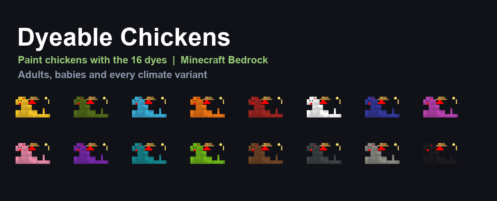

# Dyeable Chickens

Dye any chicken with the 16 dyes of Minecraft. The color is stored on the chicken, so it survives reloads, and babies inherit the color of their parents.



## Features

- All 16 dyes: white, orange, magenta, light blue, yellow, lime, pink, gray, light gray, cyan, purple, blue, brown, green, red and black.
- Works on adult chickens and baby chicks.
- Keeps the vanilla climate variants (temperate, warm and cold) and their baby versions.
- Keeps the vanilla comb, beak and legs, and only tints the body.
- One dye is consumed per painting. Painting with the same color does not consume the dye.
- Color is inherited by babies and saved with the world.
- Keeps achievements enabled: stable Script API, no `script_eval`, no experiments.

## Requirements

- Minecraft Bedrock Edition 1.26.50 or newer (Windows, Android, iOS, consoles).
- Activate **both** packs: behavior pack and resource pack.

## Installation

1. Download `dist/DyeableChickens.mcaddon`.
2. Open it with Minecraft (double click on Windows).
3. In the world settings, activate **Dyeable Chickens** in both Behavior Packs and Resource Packs.
4. Reload the world.

Manual installation: copy `behavior_pack` to the world/com.mojang `behavior_packs` folder and `resource_pack` to `resource_packs`, then enable them in the world.

## Usage

Hold a dye and interact (right click / tap) with a chicken. The chicken changes color and one dye is consumed.

- Works with chickens that already exist in the world.
- Works with baby chickens; the color stays when they grow up.
- Babies bred from dyed chickens inherit the color.
- Eggs hatched from dyed chickens produce natural-colored chicks, because the egg item does not store the color. Paint the chick after it hatches.

## Dyes and colors

| Dye | Color | Dye | Color |
| --- | --- | --- | --- |
| White | White | Gray | Dark gray |
| Orange | Orange | Light gray | Light gray |
| Magenta | Magenta | Cyan | Cyan |
| Light blue | Light blue | Purple | Purple |
| Yellow | Yellow | Blue | Blue |
| Lime | Lime | Brown | Brown |
| Pink | Pink | Green | Green |
| Red | Red | Black | Black |

## How it works

- The behavior pack overrides the vanilla chicken entity to add a client-synced integer property, `dyeable:color` (0 = natural, 1-16 = dyes).
- A script listens to `playerInteractWithEntity`, sets the property and consumes one dye.
- The resource pack overrides the chicken render controller `controller.render.chicken.v3` with arrays that combine climate (3), age (adult/baby) and color (17) for a total of 102 tinted textures.
- The vanilla `minecraft:offspring` property inheritance copies `dyeable:color` to babies.

## Project layout

```
behavior_pack/
  manifest.json
  entities/chicken.json          # vanilla chicken + dyeable:color property
  scripts/main.js
resource_pack/
  manifest.json
  entity/chicken.entity.json     # textures for every climate/age/color
  render_controllers/chicken.render_controllers.json
  textures/entity/chicken/dye/   # 96 tinted textures
docs/                            # banner and preview
dist/DyeableChickens.mcaddon     # ready to install
```

## Credits

Created by [Julianste15](https://github.com/Julianste15).

Chicken textures are derived from the Minecraft Bedrock vanilla assets. This project is not affiliated with Mojang or Microsoft.

## Español

Teñir pollos con los 16 tintes del juego. El color se guarda en el pollo y los pollitos heredan el color de sus padres.

- Funciona en pollos adultos y bebés, en las tres variantes de clima.
- Se consume un tinte por cada pintada.
- Mantiene los logros activos (API estable, sin `script_eval` ni experimentos).
- Requiere Minecraft Bedrock 1.26.50 o superior y activar el behavior pack y el resource pack.

Uso: toma un tinte y haz clic derecho sobre un pollo. Los huevos siguen saliendo pollitos naturales; píntalos al nacer.
